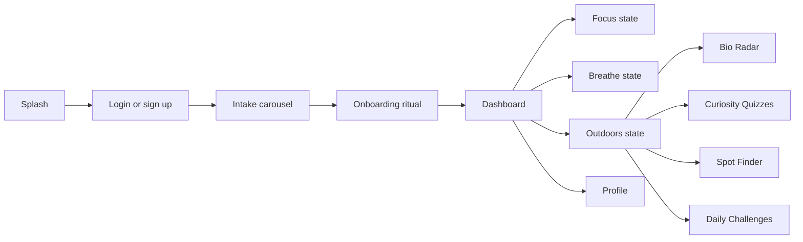
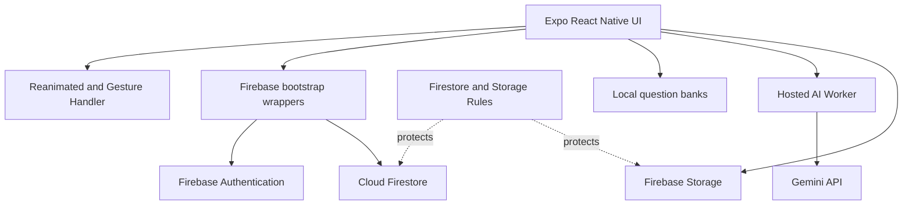

# kenetic


kenetic is a mobile wellbeing and environmental-awareness app built around
small physical actions. It helps users move between focused work, breathing
and restoration practices, and attentive outdoor exploration without turning
those activities into a passive content feed.

The app is a mobile-only React Native / Expo application for Android and iOS.
Firebase provides authentication and remote persistence. Alien Mode and
Bio Radar require the separately configured hosted AI service described below.

## Demo

Demo video: **[Google Drive demo link](https://drive.google.com/file/d/1YRzw8xiRb9WkZUY4YqnlT9OEe4CRp3Xo/view?usp=sharing)**

## Product Overview

The main flow is:



### Focus

Focus is designed for starting a task and reducing friction around the first
small action. Get Shit Done opens the chosen music app and starts the focus
timer when the user returns to Kenetic; there is no music-selection deadline.
The timer uses a saved deadline so it can resume after the app is closed.
Kenetic does not control music playback or lock other apps. Alien Mode sends
the task to Gemini with the user's consent and presents suggested small steps.
Starting a focus session stores the original task and first step in Firestore.

### Breathe

Breathe provides guided exercises such as calm down, recenter, clear mind,
and deep relax. Exercise launches and session completion data are persisted so
the dashboard can display restoration activity.

### Outdoors

The Outdoors state connects the user's real-world discoveries to lightweight
learning:

- **Bio Radar:** sends a photo to Gemini after
  consent. The result is an uncertain estimate, not a safety identification.
- **Curiosity Quizzes:** offers curated general-nature questions each UTC day,
  alongside eligible older discoveries. Questions come from a local bank rather
  than AI. New AI discoveries are not treated as verified quiz facts.
- **Spot Finder:** saves named places; optional nearby park and hiking-area
  search uses Google Places and requests location permission.
- **Daily Challenges:** offers a daily grounding activity with saved progress.

When saved, Bio Radar records the scan source, visual mode, AI result,
and session lifecycle; it does not save the photo to Firestore.
Curiosity Quizzes records the selected answer result and retention
action. The Outdoors dashboard aggregates species scanned, quiz attempts,
mastery percentage, and active learning days.

## Architecture



The application keeps Firebase calls behind `src/lib/firebase/bootstrap.ts`.
Those wrappers establish an authenticated or anonymous user before calling
the typed Firestore functions in `src/lib/firebase/firestore.ts`. This keeps
screen components focused on interaction state and prevents collection paths
from being duplicated throughout the UI.

The mobile app starts at `App.tsx`; run `npm run typecheck:app` to check its
dependency graph. Firebase Functions is a separate Node project; install its
locked dependencies with `npm ci --prefix functions` and run
`npm run typecheck:functions` to build it. The root TypeScript configuration
also includes the separate, unused `src/app` Router/template code and is not
the app-only check. Firebase's React Native persistence declaration is supplied
locally because Firebase's public TypeScript export resolves to its browser
types, while Metro uses its React Native implementation.

### AI setup and restrictions

The service in `ai-worker/` is not deployed by default. It requires a free
Cloudflare Workers account, a Gemini API key kept as a Worker secret, and the
same Firebase project ID as the app. Set `FIREBASE_PROJECT_ID` and a
comma-separated `ALLOWED_COUNTRIES` list in `ai-worker/wrangler.toml`, using
only countries where Gemini unpaid services are permitted. Requests without a
Cloudflare country or from the UK, EEA, or Switzerland are rejected. IP-based
geolocation and age self-attestation cannot guarantee eligibility; the app
must not be directed at or likely accessed by children.

Deploy only after verifying the target Cloudflare account, country list,
Firebase project, current Gemini terms and free-tier model availability. Add
the Gemini key with `npx wrangler secret put GEMINI_API_KEY` from `ai-worker`;
never put it in app code or an `EXPO_PUBLIC_` variable. Set only the Worker's
public HTTPS origin in `EXPO_PUBLIC_AI_SERVICE_URL` for the Expo preview
environment. Saving AI discoveries additionally requires deploying the updated
Firestore rules to the confirmed Firebase project. No deployment or billing
configuration is performed automatically.

Each user is shown an AI agreement before first use; the account-level
agreement covers both Alien Mode and Bio Radar and can be reviewed or
withdrawn in Profile. Each task or photo is sent only after the user initiates
that action. The app checks the agreement with Firestore before each AI request,
so a connection is required. Unpaid Gemini input and
output may be reviewed by people and used to improve Google's products; do not
send personal, confidential, or sensitive content. Daily limits are 10
requests per Firebase user and 100 total, resetting at midnight UTC; rejected
provider calls also use a request. Google's own quota may be lower and resets
on its own schedule. The hosting plan and Google project must remain on their
free tiers; a usage cap does not prevent charges if billing is enabled.

User-owned records are stored below:

```text
users/{uid}/
  sessions/
  scanHistory/
  quizHistory/
  outdoorFeatureLaunches/
  dashboardSelections/
  metrics/
  devices/
  notificationEvents/
  savedPlaces/
  challengeProgress/
```

## Technology

- React 19.3 and React Native 0.88
- Expo SDK 58
- TypeScript
- Firebase JavaScript SDK 12
- Firebase Authentication, Cloud Firestore, and Firebase Storage
- `react-native-reanimated` for tweening, fades, spring motion, morphing,
  progress states, and screen transitions
- `react-native-gesture-handler` for swipe, drag, and hold interactions
- `expo-haptics` for micro-actions and tactile feedback
- `expo-camera`, `expo-location`, `expo-sensors`, and
  `expo-notifications` for native capabilities
- `expo-blur` and `expo-linear-gradient` for visual depth
- Optional Cloudinary profile-photo uploads
- Optional Google Places integration for Spot Finder work

## Requirements

- Node.js 22.13 or newer in the 22.x line, 24.3 or newer in the 24.x line,
  26.x, or 27 or newer
- npm
- An Expo-compatible device with Expo Go, or an Android/iOS simulator
- A Firebase project for remote development or production
- Firebase CLI for rules, storage, functions, and emulator commands:

```bash
npm install -g firebase-tools
firebase login
```

## Installation

### Frontend: local Expo development

1. Clone the repository and install dependencies:

   ```bash
   git clone <repository-url>
   cd Kenetic
   npm install
   ```

2. Create a local environment file:

   ```bash
   copy .env.example .env.local
   ```

   On macOS/Linux, use `cp .env.example .env.local` instead.

3. Fill in the Firebase app values from Firebase Console. The required
   values are documented in `.env.example` and loaded by
   `src/lib/firebase/config.ts`:

   ```dotenv
   EXPO_PUBLIC_FIREBASE_API_KEY=...
   EXPO_PUBLIC_FIREBASE_AUTH_DOMAIN=...
   EXPO_PUBLIC_FIREBASE_PROJECT_ID=...
   EXPO_PUBLIC_FIREBASE_MESSAGING_SENDER_ID=...
   EXPO_PUBLIC_FIREBASE_APP_ID=...
   ```

   Firebase's JavaScript SDK uses this app configuration on mobile too.
   `EXPO_PUBLIC_FIREBASE_STORAGE_BUCKET` is optional and is not needed for the
   free-tier setup.

4. Start Expo:

   ```bash
   npx expo start
   ```

   Use `npx expo start --lan` when the phone and computer are on the same
   network. If the default port is occupied, Expo will offer another port.
   Scan the QR code from Expo Go. On a physical iPhone, the Expo CLI and
   Expo Go must be signed in to the same Expo account for a development
   server. This QR code is not a public distribution method for iPhone users.
   See [Expo's sign-in guide](https://docs.expo.dev/troubleshooting/expo-go-sign-in-required/).

Useful frontend commands:

```bash
npm run start
npm run android
npm run ios
npm run build:android:apk
npm run test:outdoor-data
npx expo export --platform android
```

The APK build uses Expo Build's free internal-distribution profile. It requires
an Expo account and the required `EXPO_PUBLIC_FIREBASE_*` values in the
project's Expo `preview` environment; local `.env.local` files are not sent to
remote builds. The resulting APK can be shared directly without publishing
through an app store.

### Backend: Firebase project setup

1. Create a Firebase project in the Firebase Console.
2. Register a Web app to get the Firebase JavaScript SDK configuration and
   copy its values into `.env.local`. This does not enable web support in
   Kenetic.
3. Enable the authentication providers required by the app:
   - Anonymous authentication for first-use sessions.
   - Email/password for account registration and login.
4. Create a Cloud Firestore database.
5. Select the Firebase project locally:

   ```bash
   firebase use <project-id>
   ```

6. Deploy the Firestore security rules:

   ```bash
   npm run firebase:deploy:rules
   ```

The Firestore rules enforce authenticated ownership below `users/{uid}` and
validate enums, timestamps, coordinates, quiz records, scan records, and
session lifecycle fields. The free Spark plan supports Authentication and
Firestore within Firebase's published quotas. Firebase Storage and Cloud
Functions require a billing-enabled plan, so leave them disabled to keep the
project at $0. Profile-photo uploads need optional Cloudinary configuration
or should be left unused.

### Backend: Firebase Functions

The repository includes an optional `functions/` package configured for
Node.js 20. Deploying it requires a billing-enabled Firebase plan.
Install and build it independently when functions are needed:

```bash
cd functions
npm install
npm run build
cd ..
```

Deploy functions from the repository root:

```bash
npm run firebase:deploy:functions
```

The current core Bio Radar and Curiosity Quiz flows do not require an AI
Cloud Function. Their matching and question selection are deterministic and
local; Firestore stores the resulting activity and user history.

### Local Firebase emulators

For offline backend development, enable emulators in `.env.local`:

```dotenv
EXPO_PUBLIC_USE_FIREBASE_EMULATORS=true
EXPO_PUBLIC_FIREBASE_PROJECT_ID=demo-kenetic
```

Start the configured services:

```bash
npx firebase emulators:start
```

The configured ports are:

| Service        | Port |
| -------------- | ---: |
| Authentication | 9099 |
| Firestore      | 8080 |
| Functions      | 5001 |
| Storage        | 9199 |
| Emulator UI    | 4000 |

The emulator project ID and frontend environment must match. Emulator data
is local and should not be treated as production data.

### Staging and production environments

Keep separate Firebase projects for development, staging, and production.
Use one environment file per deployment target and never commit secrets:

```text
.env.local                 local machine values
.env.development.example   development template
.env.production.example    production template
```

Before a staging or production build:

1. Point `EXPO_PUBLIC_FIREBASE_PROJECT_ID` and the other Firebase values at the
   target project.
2. Deploy that project's rules and storage rules.
3. Verify the enabled Auth providers and authorized domains.
4. Restrict Google API keys by application and API, especially Places keys.
5. Verify camera and location configuration in `app.json`.
6. Export or build with the target environment loaded.

Do not expose Firebase service-account JSON or admin credentials in Expo
environment variables. Public Expo variables are bundled into the client and
must only contain client-safe configuration.

## How To Use The App

### First launch

1. Open the app in Expo Go or a native build.
2. Move through the splash, authentication, intake, and onboarding screens.
3. Complete the onboarding ritual to reach the gateway and dashboard.
4. Drag Focus, Breathe, or Outdoors upward on the dashboard to open it.

Signed-in users resume unfinished onboarding after restarting. If startup or
onboarding cannot load or save their data, the app shows an error and retry
option rather than silently skipping the step.

### Navigation and micro-actions

- Drag the labelled action to the right when prompted. On supported screen
  readers, new swipe actions also expose an activate accessibility action.
- Account choices, email sign-in and signup, the initial intention,
  onboarding completion, dashboard states, and profile choices
  also expose screen-reader activation. Signup activation agrees to the terms
  and submits the form, just like the drag gesture. Screen-reader coverage is
  still partial and requires VoiceOver and TalkBack device testing.
- Swipe right on navigation rows to return to the previous state.
- On screens with text fields, scroll to reach the rest of the form and drag
  the page to dismiss the keyboard.
- Drag text tokens into their muted target states to confirm an action.
- Hold the Bio Radar reticle for two seconds to begin a scan.
- Haptic feedback marks important starts, drops, successes, warnings, and
  failures.
- In Daily Challenges, drag to start, complete, reopen, or clear today's
  progress. In Spot Finder, save a named place and drag to edit or delete it.
- Nearby search is optional: it requests location permission and sends
  coordinates to Google Places. It requires separate API configuration and may
  incur charges. Manually saved places do not require Google Places.
- Reanimated tweening and spring motion provide progress, snap, reveal, and
  screen-transition feedback.

### Bio Radar

1. Open **Outdoors** and choose **Bio Radar**.
2. Read and agree to the AI privacy notice, then grant camera permission.
3. Hold the reticle for two seconds to send a photo.
4. Review the AI estimate and uncertainty. Do not use it to make safety decisions.
5. Drag `discovered` onto its target to save the result. AI discoveries are not
   added to Curiosity Quizzes.

The scan is stored in `users/{uid}/scanHistory`. A matching outdoors session is
started before processing and completed when the discovery is saved, or marked
abandoned if the user exits early.

### Curiosity Quizzes

1. Open **Curiosity Quizzes** from Outdoors.
2. The lobby loads scans marked for daily quizzes from Firestore.
3. Drag `drag to recall` down into the sand pool.
4. Read the species-specific question and drag one answer upward into the
   glowing `drag truth here` circle.
5. The photo sharpens and a green or orange feedback wave indicates the result.
6. Read the verified ecological fact.
7. Drag `retained` onto the `RETAINED` target to save the result and move to
   the next queued discovery.

The quiz queue is deterministic and remote-backed. It is built from recent
scan records, deduplicated by species for the active queue, and excludes scan
records already answered by their scan ID. A failed remote load has a retry
path instead of being presented as an empty queue.

### Dashboard and profile

The dashboard shows state navigation and persisted activity. Outdoors metrics
include species scanned, quiz answers, mastery index, and active learning days.
Profile contains account and preference management. Anonymous activity can be
associated with a registered account through the authentication flow.

## Environment Variables

Required Firebase client configuration:

```dotenv
EXPO_PUBLIC_FIREBASE_API_KEY=
EXPO_PUBLIC_FIREBASE_AUTH_DOMAIN=
EXPO_PUBLIC_FIREBASE_PROJECT_ID=
EXPO_PUBLIC_FIREBASE_STORAGE_BUCKET=
EXPO_PUBLIC_FIREBASE_MESSAGING_SENDER_ID=
EXPO_PUBLIC_FIREBASE_APP_ID=
```

Optional integrations:

```dotenv
EXPO_PUBLIC_USE_FIREBASE_EMULATORS=false
EXPO_PUBLIC_FIREBASE_ENV=development
EXPO_PUBLIC_GOOGLE_PLACES_API_KEY=
EXPO_PUBLIC_GOOGLE_WEB_CLIENT_ID=
EXPO_PUBLIC_GOOGLE_ANDROID_CLIENT_ID=
EXPO_PUBLIC_GOOGLE_IOS_CLIENT_ID=
EXPO_PUBLIC_CLOUDINARY_CLOUD_NAME=
EXPO_PUBLIC_CLOUDINARY_UPLOAD_PRESET=
```

## Project Structure

```text
App.tsx                         Expo entry point
app.json                        Expo permissions and native configuration
src/app/                        App routing and layout
src/screens/                    Feature screens and experiences
src/components/                 Shared UI components
src/lib/firebase/app.ts         Firebase app initialization
src/lib/firebase/auth.ts        Auth and anonymous-user helpers
src/lib/firebase/bootstrap.ts   Auth-aware feature wrappers
src/lib/firebase/firestore.ts   Types, collections, CRUD, and metrics
src/lib/firebase/storage.ts     Storage helpers
src/constants/                  Theme constants
src/theme/                      Shared colors and visual tokens
firestore.rules                 Firestore ownership and validation rules
storage.rules                   Storage ownership rules
firebase.json                   Firebase services and emulator ports
functions/                      Optional Firebase Functions package
assets/images/kenetic-icon.png  Application icon PNG
```

## Verification

Run the production-style bundle check before sharing a build:

```bash
npm run typecheck:app
npm run typecheck:functions
npm run test:auth
npm run test:account-restore
npm run test:breathing
npm run test:curated-quiz
npm run test:session-storage
npm run test:focus-timing
npm run test:ai-worker
node --test scripts/test-ai-consent.cjs
npm run test:outdoor-data
npm run test:firestore-rules
npm run test:storage-rules
npx expo export --platform all
```

The outdoor data tests use an in-memory Firestore mock. They do not verify
deployed Firebase rules, offline behavior, or physical-device interaction.
The rules tests use local Firebase emulators and the demo project ID, never a
live project. They require Java on `PATH` and may download emulator binaries
on first use. Passing them does not deploy rules or configure live Storage.

For backend changes, deploy or test the rules against the intended Firebase
project. For device features, test permissions and gestures on a physical
device because camera and haptics
are not fully represented in a web browser.

## Known Product Boundaries

- Sign-in and signup use email and password. Apple and Google sign-in options
  are not available; existing provider-only accounts cannot sign in through
  the current app after signing out.
- Push notification prompts and settings are unavailable because delivery is
  not implemented. Previously saved notification preferences remain stored.

- Bio Radar sends a photo to the configured AI service after consent; its
  species identification is an uncertain estimate and not safety advice.
- Curiosity Quiz questions come from a maintained local question bank; they
  are not generated dynamically by an AI model.
- Nearby search requires Google Places configuration and may incur charges;
  adding and managing named places manually does not require Google Places.
- Bio Radar photos are not saved to Firestore. Live Firebase Storage requires
  billing-enabled configuration and has not been validated in this setup;
  optional profile-photo uploads require separate Cloudinary configuration.
- New breathing and Alien Mode timers are stored per account (and breathing
  exercise). Older locally saved timers lack account identification and cannot
  safely be resumed automatically after this update; their Firestore records
  remain unchanged.
- If saving an expired breathing or Alien Mode session fails, the user can
  retry saving it. Leaving preserves the local session for a later retry.

## License

All rights reserved.

## Acknowledgments

Thanks to Tsungai Katsuro and William Basson for their support and
contributions. We also acknowledge these AI tools and the Stack Overflow
community:

[](https://gemini.google.com/)
[](https://chatgpt.com/)
[](https://stackoverflow.com/)

## Author

[Dhiali](https://github.com/Dhiali)
