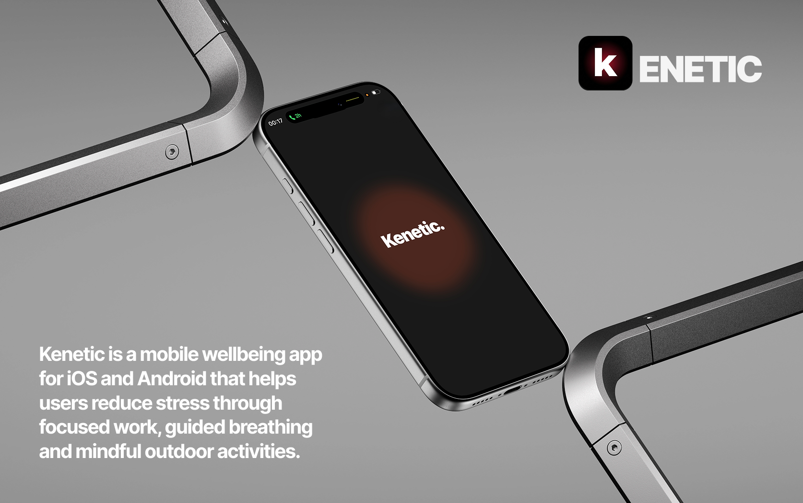
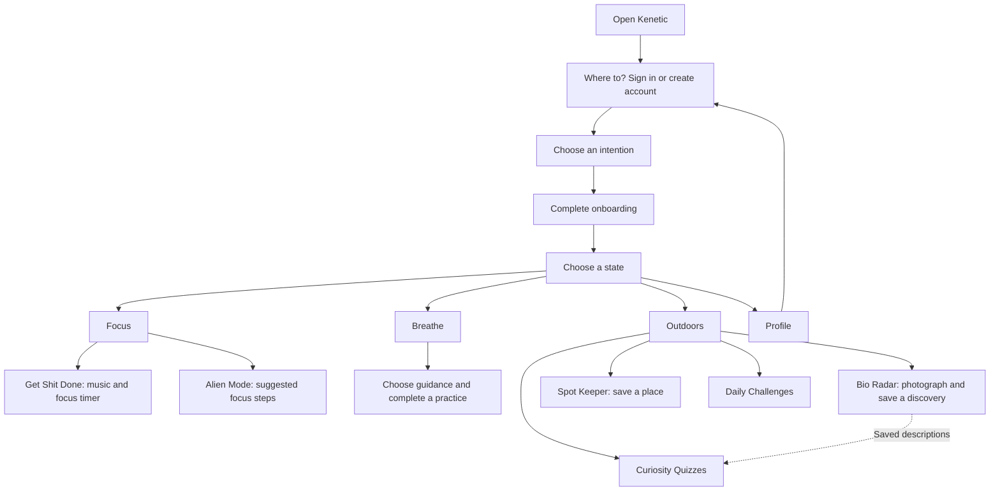
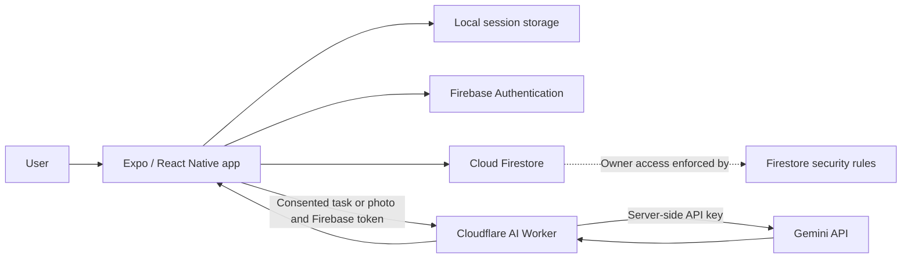
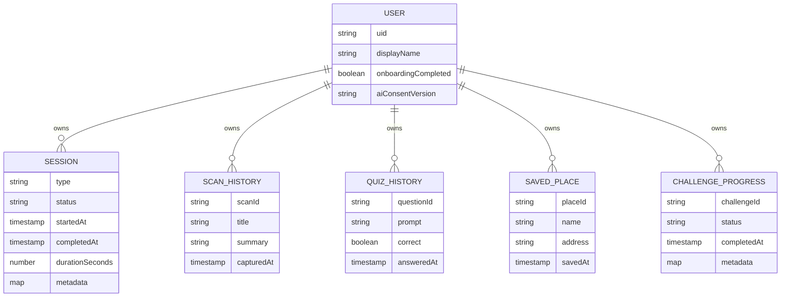

# kenetic



## Table of Contents

- [About Kenetic](#about-kenetic)
- [Tech Stack](#tech-stack)
- [Installation](#installation)
  - [Prerequisites](#prerequisites)
  - [How to Install](#how-to-install)
- [Features](#features)
  - [Account and Onboarding](#account-and-onboarding)
  - [State Dashboard](#state-dashboard)
  - [Get Shit Done](#get-shit-done)
  - [Alien Mode](#alien-mode)
  - [Guided Breathing](#guided-breathing)
  - [Bio Radar](#bio-radar)
  - [Curiosity Quizzes](#curiosity-quizzes)
  - [Spot Keeper](#spot-keeper)
  - [Daily Challenges](#daily-challenges)
  - [Activity and Profile](#activity-and-profile)
- [Development Process](#development-process)
  - [Theme and Creative Direction](#theme-and-creative-direction)
  - [Interaction and Experience Decisions](#interaction-and-experience-decisions)
  - [Technical Decisions](#technical-decisions)
  - [User Flow](#user-flow)
  - [System Architecture](#system-architecture)
  - [Data Model](#data-model)
  - [Iteration and Verification](#iteration-and-verification)
- [Final Outcome](#final-outcome)
  - [Before and After](#before-and-after)
  - [Demo Video](#demo-video)
  - [Test Coverage and Results](#test-coverage-and-results)
- [Conclusion](#conclusion)
  - [Highlights](#highlights)
  - [Challenges and Solutions](#challenges-and-solutions)
  - [Future Improvements](#future-improvements)
- [License](#license)
- [Acknowledgments](#acknowledgments)
- [Author](#author)

## About Kenetic

kenetic is a mobile wellbeing and environmental-awareness app built around
small physical actions. It helps users move between focused work, breathing
and restoration practices, and attentive outdoor exploration without turning
those activities into a passive content feed.

The app is a mobile-only React Native / Expo application for Android and iOS.
Firebase provides authentication and remote persistence. Alien Mode and
Bio Radar require the separately configured hosted AI service described below.

## Tech Stack

| Technology | Role |
| --- | --- |
|  **React Native** | Cross-platform mobile interface |
|  **Expo** | Mobile development and native capabilities |
|  **TypeScript** | Application and backend code |
|  **Firebase** | Authentication and Cloud Firestore persistence |
|  **Cloudflare Workers** | Hosted AI service |
|  **Gemini** | AI-assisted task breakdown and nature discovery |

## Installation

These steps set up the mobile frontend, Firebase backend, and hosted AI service
for a development preview. They do not publish an app to an app store. Firebase
Authentication and Firestore can be used on the Spark plan within their free
quotas; Cloudflare and Gemini also have usage limits. Check current pricing and
account settings before deploying: free-tier limits do not guarantee zero
charges if billing is enabled.

### Prerequisites

**Software and device**

- [Git](https://git-scm.com/downloads) to clone the repository.
- [Node.js and npm](https://nodejs.org/en/download): Node.js 22.13 or newer in
  the 22.x line, 24.3 or newer in the 24.x line, 26.x, or 27 or newer. npm is
  included with Node.js. Check both with `node --version` and `npm --version`.
- A phone with [Expo Go](https://expo.dev/go) compatible with this project's
  Expo SDK, or an Android emulator / iOS simulator. See
  [Expo's environment setup guide](https://docs.expo.dev/get-started/set-up-your-environment/).
  For a physical iPhone, sign in to the same Expo account on Expo Go and the
  CLI; see [Expo's sign-in guide](https://docs.expo.dev/troubleshooting/expo-go-sign-in-required/).
- An [Expo account](https://expo.dev/signup) for the iPhone development
  preview. The computer and phone should be on the same network for LAN use.
- Java is only required for the optional
  [Firebase emulator and rules tests](https://firebase.google.com/docs/emulator-suite/install_and_configure).

**Accounts and keys**

- A [Firebase project](https://console.firebase.google.com/) with
  Authentication and Cloud Firestore. Register a **Web app** to obtain the
  Firebase JavaScript configuration; this does not make Kenetic a web app.
  Enable **Anonymous** and **Email/Password** sign-in.
- For Alien Mode and Bio Radar, a [Cloudflare account](https://dash.cloudflare.com/sign-up),
  [Workers access](https://developers.cloudflare.com/workers/get-started/guide/),
  and a [Gemini API key](https://aistudio.google.com/apikey). Confirm that the
  configured Gemini model and unpaid access are available in your region.
  The AI service is optional for the rest of the app, but those two features
  cannot work without it.
- The project uses the Firebase CLI installed by `npm ci`; Wrangler is run
  through `npx` for AI deployment. React Native, Expo, TypeScript, and other
  app packages are installed from the repository's lockfile, not individually.
- Optional profile-photo uploads require a [Cloudinary account](https://cloudinary.com/)
  and an unsigned upload preset. Google Places and Google/Apple sign-in keys
  are not needed for the current manual Spot Keeper and email/password flows.
  Firebase Storage and deployed Firebase Functions require a billing-enabled
  plan; they are not required for the core free-tier setup.

### How to Install

Run the following commands in a terminal. Commands start from the project root
unless a step changes directories.

**1. Clone the project and install frontend dependencies**

```bash
git clone https://github.com/Dhiali/Kenetic.git
cd Kenetic
npm ci
```

`npm ci` installs the locked versions. If dependencies are deliberately changed,
update the manifest and lockfile together; do not upgrade Expo or other core
packages merely to run the existing project.

**2. Configure Firebase and its security rules**

1. In the [Firebase Console](https://console.firebase.google.com/), create a
   project, register a Web app, and copy its configuration. Enable Anonymous
   and Email/Password under Authentication, then create a Cloud Firestore
   database. See [Firebase setup](https://firebase.google.com/docs/web/setup)
   and [Firestore setup](https://firebase.google.com/docs/firestore/quickstart).
2. Copy the environment template:

   ```powershell
   Copy-Item .env.example .env.local
   ```

   On macOS/Linux, run `cp .env.example .env.local` instead. Do not overwrite
   an existing `.env.local` containing configuration you want to keep.
3. Fill in these values in `.env.local` from the Firebase Web app settings:

   ```dotenv
   EXPO_PUBLIC_FIREBASE_API_KEY=your-firebase-api-key
   EXPO_PUBLIC_FIREBASE_AUTH_DOMAIN=your-project.firebaseapp.com
   EXPO_PUBLIC_FIREBASE_PROJECT_ID=your-project-id
   EXPO_PUBLIC_FIREBASE_MESSAGING_SENDER_ID=your-sender-id
   EXPO_PUBLIC_FIREBASE_APP_ID=your-app-id
   ```

4. Sign in to Firebase and deploy **only** the Firestore rules to the project
   you created. Replace the placeholder with your actual project ID:

   ```bash
   npx firebase login
   npx firebase deploy --only firestore:rules --project YOUR_FIREBASE_PROJECT_ID
   ```

   This changes the rules on the selected live Firebase project. Confirm the
   project ID first; it does not deploy Functions or Storage.

**3. Set up the AI backend for Alien Mode and Bio Radar**

1. In [Google AI Studio](https://aistudio.google.com/apikey), create a Gemini
   API key. Keep it private.
2. Open `ai-worker/wrangler.toml`. Set `FIREBASE_PROJECT_ID` to the same
   Firebase project ID used in `.env.local`; the checked-in value is an example,
   not your project. Set `ALLOWED_COUNTRIES` to comma-separated ISO country codes
   where unpaid Gemini use is permitted, and choose a Worker name appropriate
   for your Cloudflare account. Preserve the Durable Object binding and migration.
3. From the project root, sign in to Cloudflare, save the key as a Worker
   secret, and deploy:

   ```bash
   cd ai-worker
   npx wrangler login
   npx wrangler secret put GEMINI_API_KEY
   npx wrangler deploy
   cd ..
   ```

   Enter the Gemini key when prompted; never put it in `.env.local`, app code,
   or an `EXPO_PUBLIC_` variable. Wrangler prints the deployed Worker's HTTPS
   address. See [Wrangler documentation](https://developers.cloudflare.com/workers/wrangler/).
4. Add the Worker origin to `.env.local`:

   ```dotenv
   EXPO_PUBLIC_AI_SERVICE_URL=https://your-worker.example.workers.dev
   ```

   Review the restrictions below before using or sharing the app.

**AI privacy, eligibility, and limits**

- The Worker rejects requests without a Cloudflare country and requests from
  the UK, EEA, or Switzerland. Country detection and age self-attestation
  cannot guarantee eligibility; the app must not be directed at or likely
  accessed by children. Check current Gemini terms and free-tier availability
  before deployment.
- The app checks the account's AI agreement before each request. Users can
  review or withdraw it in Profile; a task or photo is sent only when the
  user initiates the action. Unpaid Gemini input and output may be reviewed by
  people and used to improve Google's products, so do not send personal,
  confidential, or sensitive content.
- Limits are 10 requests per Firebase user and 100 total per UTC day. Rejected
  provider calls also count. Provider quotas may be lower, and enabling billing
  may incur charges despite these caps.

**4. Start the frontend**

```bash
npx expo login
npx expo start --lan
```

Sign in with the Expo account used on your phone. Open Expo Go and scan the QR
code. On iPhone, use the Camera app to open the
link; on Android, use the Expo Go scanner. If the port is occupied, accept
Expo's offered alternative. After changing `.env.local`, restart Expo and
fully reload the app so public variables are included in the bundle. This LAN
preview is for development, not public distribution.

**5. Check the installation**

```bash
npm run typecheck:app
npm run test:breathing
npm run test:outdoor-data
npm run test:auth
npm run test:ai-worker
```

Create an account on the phone and verify Firestore-backed actions. For AI,
accept the in-app agreement and test Alien Mode and Bio Radar. If AI says it
is not configured, check the Worker URL in `.env.local`, restart Expo, and
reload. More checks are listed under [Test Coverage and Results](#test-coverage-and-results).

**Optional: Firebase Functions**

The separate `functions/` package uses Node.js 20 and is not required for the
core app or hosted AI service. To install and build it:

```bash
npm ci --prefix functions
npm run typecheck:functions
```

Deploying Functions requires a billing-enabled Firebase plan. Only after
reviewing costs and selecting the intended project, deploy with
`npx firebase deploy --only functions --project YOUR_FIREBASE_PROJECT_ID`.
Firebase emulators can be used for the repository's rules tests; the mobile
app is not currently wired to connect to them, so use a configured Firebase
project for the app itself.

**Optional: Profile-photo uploads**

Create an unsigned upload preset in Cloudinary using its
[upload preset guide](https://cloudinary.com/documentation/upload_presets), then
set `EXPO_PUBLIC_CLOUDINARY_CLOUD_NAME` and
`EXPO_PUBLIC_CLOUDINARY_UPLOAD_PRESET` in `.env.local`. These values are public
client configuration; configure the preset's restrictions appropriately and
review the provider's usage limits. Restart Expo and reload the app after editing
the file.

## Features

The screenshot notes below identify the screens to capture for the feature
mockups. Add your finished mockups here when they are ready.

### Account and Onboarding

Users can create an account or sign in with email and password, choose an
initial intention, and complete the onboarding flow. Signed-in users can resume
their saved progress when they return.

!(assets/images/iPhone 15 Pro)

### State Dashboard

The dashboard offers three paths—Focus, Breathe, and Outdoors. Users drag a
state upward to enter its activities.

**Mockup screenshot:** Capture the main dashboard with all three state choices
visible.

### Get Shit Done

Users choose Apple Music or Spotify and a focus duration. The focus timer starts
when they return to Kenetic after opening their music app.

**Mockup screenshot:** Capture the **Stay with it** screen while a focus timer
is running.

### Alien Mode

With the user's agreement, Alien Mode sends an overwhelming task to the AI
service and presents small suggested steps. Users choose a 1–10 minute focus
session, finish a step, and review the next one.

**Mockup screenshot:** Capture the **Start small** screen showing the first
suggested step and focus-time choices.

### Guided Breathing

Four guided practices offer visual and haptic cues. Users can choose flexible
guidance or chest-based, motion-sensitive guidance before starting. In chest
mode, movement pauses the cues while the session timer continues.

**Mockup screenshot:** Capture an active breathing session showing the
countdown and current breathing cue.

### Bio Radar

After AI consent, users photograph something in nature and receive a possible
discovery with a description and uncertainty. Saved descriptions can later be
used in quizzes. Results are AI estimates, not verified identifications or
safety advice; photos are not saved to Firestore.

**Mockup screenshot:** Capture the **Possible discovery** result card with its
description and Save action.

### Curiosity Quizzes

Users revisit descriptions saved through Bio Radar and answer curated
general-nature questions. Answers are saved, and daily questions refresh at
midnight UTC.

**Mockup screenshot:** Capture a quiz question with its answer choices visible,
preferably one based on a saved Bio Radar discovery.

### Spot Keeper

Users manually save, rename, and delete places they want to revisit. Spot Keeper
does not search for nearby places.

**Mockup screenshot:** Capture **Spot keeper** with at least one saved place
visible.

### Daily Challenges

Each account receives a grounding activity for a rolling 24-hour window. A
countdown shows when the next challenge arrives, and completed challenges are
saved in a history list.

**Mockup screenshot:** Capture **A moment outside** after completing a
challenge, showing the countdown and completed-challenge list.

### Activity and Profile

The state dashboards show saved activity, while Profile lets users manage
their account and review or withdraw their AI agreement.

**Mockup screenshot:** Capture **Your focus activity** on the Focus dashboard
with its recent activity and mode breakdown visible.

## Development Process

Kenetic was developed around the idea that a small physical action can help
someone move from intention to activity. The app brings focused work,
breathing, and outdoor exploration together without treating wellbeing as a
passive content feed.

### Theme and Creative Direction

The interface uses a dark backdrop, bold type, soft gradients, and animated
shapes to create a calm but active visual identity. Each state has its own
accent: rose for **Focus**, warm orange for **Breathe**, and green for
**Outdoors**. These colours help distinguish the experiences while the shared
card layouts and navigation keep the app recognisable as one product.

The design emphasises a single next action: choosing a state, beginning a
short focus step, following a breathing cue, or looking more closely at
something outside. Copy and activity summaries provide context without
claiming to diagnose or measure a user's wellbeing.

### Interaction and Experience Decisions

- **Movement as interaction:** Swipes, drags, holds, animation, and haptic
  feedback make navigation and confirmation feel like deliberate small actions.
  Some gestures also expose screen-reader actions; full device accessibility
  testing remains outstanding.
- **Feature-first dashboards:** Focus, Breathe, and Outdoors present their
  activities before the user's saved activity summaries, helping users find
  what they can do next.
- **Small, manageable steps:** Alien Mode presents suggested steps with
  selectable 1–10 minute timers. Breathing offers a choice between flexible
  and chest-based guidance.
- **Learning through discovery:** Bio Radar results can be saved and revisited
  in Curiosity Quizzes. Spot Keeper uses manually saved places rather than
  implying that a nearby-search service is available.
- **A continuing invitation:** Daily Challenges use a rolling 24-hour window;
  a new activity appears whether or not the previous one was completed.

### Technical Decisions

- **Mobile frontend:** React Native and Expo support the iOS and Android
  codebase. Gesture Handler, Reanimated, and Expo haptics support the
  movement-led interface.
- **Account-scoped data:** Firebase Authentication identifies users and
  Firestore stores their profiles and activity. Owner-scoped security rules
  protect user data; Firebase bootstrap helpers centralise access to it.
- **Recoverable sessions:** Focus and breathing timers use locally saved,
  account-scoped session information so they can be restored. Completion is
  saved remotely, with an explicit retry path if saving fails.
- **Consent-led AI:** Alien Mode and Bio Radar require an account-level AI
  agreement and an explicit action before sending a task or photo to the
  hosted Cloudflare Worker. Gemini credentials stay on the Worker, not in the
  mobile app. Bio Radar results are presented as uncertain estimates.
- **Cost-aware services:** The core setup uses Firebase Authentication and
  Firestore and a separately configured AI Worker, subject to provider free
  quotas and eligibility. Optional Firebase Functions and Storage have
  different billing requirements; see [Installation](#installation).

### User Flow

This diagram shows the main routes. Returning users can resume their saved
onboarding state or reach the dashboard after signing in.



### System Architecture

The app uses Firebase for account and activity data. For an AI request, the
app checks the user's agreement, then sends the request to the Worker, which
verifies the Firebase token and calls Gemini. The Worker does not receive a
Gemini key from the app.



### Data Model

The following is a **conceptual ERD** of the main user-owned Firestore records,
not a relational database schema. Records are stored in subcollections under
`users/{uid}`; the connecting lines indicate ownership, not enforced SQL
foreign keys. Additional collections record intentions, feature launches,
dashboard selections, metrics, and device-related events.



Some fields are optional. A saved discovery's description can be used to
create a quiz question; quiz history stores the question ID and result rather
than an enforced relationship to the scan. The challenge collection also
stores the per-account rolling schedule anchor.

### Iteration and Verification

The interface and flows were refined through an iPhone walkthrough, including
changes to focus sessions, Bio Radar, quizzes, saved places, challenges,
breathing, and logout. Automated checks cover selected timing, persistence,
authentication, and UI conventions; iOS bundling was also checked. Android
and screen-reader device testing were not included in that walkthrough, so the
project should not be presented as fully verified on those platforms.

## Final Outcome

Kenetic brings Focus, Breathe, and Outdoors together in a mobile app designed
around small, intentional actions. Users can complete guided activities,
revisit their progress, and save discoveries and places to their account.

### Before and After

This comparison uses **8 November 2026 at 04:08 (UTC+02:00)** as the
48-hour cutoff, measured from 10 November 2026 at 04:08. The "before" is the
latest commit before that cutoff, from 27 August 2026. The "after" summarises
the changes reflected in the recent commits and the current README. Git
records when changes were committed, not necessarily when each edit was made,
so this is a snapshot comparison rather than an exact log of work hours.

| Area | Before | After |
| --- | --- | --- |
| **Foundation** | A React Native and Expo SDK 54 app with authentication, onboarding, a state dashboard, and Firebase-backed data. | Upgraded to Expo SDK 58 and React Native 0.88, with a mobile-only configuration, updated app branding, and an app-specific TypeScript check. |
| **Interface** | Focus, Breathe, and Outdoors had their core screens and gesture-led identity. | Refined the account, onboarding, dashboard, Focus, Breathe, and Outdoors screens with more consistent cards, navigation, animation, and capitalisation. |
| **Focus** | Focus activities and locally generated Alien Mode suggestions were available. | Get Shit Done opens the selected music service and starts its timer when the user returns. Alien Mode uses AI-generated steps, selectable short timers, and recoverable plans. |
| **Breathe** | Guided breathing exercises and session tracking were present. | Exercise rhythms and screens were refined, with flexible or chest-based guidance and account-scoped session recovery. |
| **Bio Radar and quizzes** | Bio Radar used deterministic local matching, while quizzes used local question content. | Bio Radar analyses photos through the hosted AI service. Quizzes include curated nature questions and recall questions based on saved discovery descriptions. |
| **Places and challenges** | Spot Finder and Daily Challenges were described as reserved features. | Spot Keeper supports manually saving, editing, and deleting places. Daily Challenges save progress and completed history, congratulate users, and refresh on a rolling 24-hour schedule. |
| **Accounts and reliability** | Firebase authentication and user-owned records were in place. | Account restoration, sign-out, session recovery, failed-save retries, and error reporting were improved. AI use now requires a shared, revocable account agreement. |
| **Documentation and checks** | The project had a README and demo link. | The README now includes setup instructions, feature mockup prompts, design decisions, diagrams, and verification results. Automated tests and Firebase rules tests were added. |

These are representative changes, not a claim that every feature or platform
has been exhaustively tested. See [Test Coverage and Results](#test-coverage-and-results).

### Demo Video

Watch the **[Kenetic demo on Google Drive](https://drive.google.com/file/d/1YRzw8xiRb9WkZUY4YqnlT9OEe4CRp3Xo/view?usp=sharing)**.

### Test Coverage and Results

The automated checks below were run on **10 November 2026**. The iPhone
walkthrough was completed separately.

| Check | Result | Scope |
| --- | --- | --- |
| Automated tests | 48 passed, 0 failed, 0 skipped | All 16 non-emulator test files |
| App TypeScript check | Passed | Application type-check |
| iPhone walkthrough | Features tested by the project owner | Manual interaction on an iPhone |

The automated tests cover selected account restoration and logout, AI consent
and Worker validation, focus and breathing timers, session recovery, saved
places, quizzes, daily challenges, and UI conventions. Some use mocks or
source-level checks rather than a running app or live services.

The 48 passing tests are a **test result, not a code-coverage percentage**.
An app-wide line or branch coverage percentage has not been measured. The
Firestore and Storage emulator rule tests were not included in this run.
Android and screen-reader device testing were also not included in the iPhone
walkthrough.

To reproduce the non-emulator test run in PowerShell from the project root:

```powershell
$files = Get-ChildItem scripts -File |
  Where-Object { $_.Name -match '^test-.*\.(cjs|mjs)$' -and $_.Name -notin @('test-firestore-rules.cjs', 'test-storage-rules.cjs') } |
  ForEach-Object { $_.FullName }
node --test $files
npm run typecheck:app
```

For additional checks, Java must be on `PATH` for the local rules emulators:

```bash
npm run test:firestore-rules
npm run test:storage-rules
npx expo export --platform all
```

The rules tests use a demo Firebase project and may download emulator binaries.
They do not deploy rules or configure live Storage. The outdoor data tests use
an in-memory Firestore mock and do not verify live rules or offline behaviour.

## Conclusion

Kenetic brings its stress-reduction theme into everyday interactions: a user
can take a small step towards a task, pause for a breathing practice, or
observe something outdoors. Building the app showed how much the quality of
those experiences depends on both the visual design and the reliability of
the flows behind it.

### Highlights

- **A cohesive mobile experience:** Focus, Breathe, and Outdoors have distinct
  colours and activities while sharing a gesture-led visual language.
- **Meaningful actions and progress:** Focus sessions, breathing practices,
  saved discoveries and places, quizzes, and challenges give users ways to
  act and return to their progress.
- **Iteration through use:** The iPhone walkthrough helped identify and refine
  practical issues, including the music handoff, breathing flow, and logout.
- **Thoughtful AI use:** Alien Mode and Bio Radar add personalised assistance
  while requiring an account agreement and presenting identifications as
  uncertain estimates.

### Challenges and Solutions

| Challenge | Approach |
| --- | --- |
| Keeping the app compatible with the available iPhone preview | Upgraded Expo from SDK 54 to SDK 58 and checked iOS exports and the app on the project's iPhone. Sharing a preview with unrelated Expo accounts remains unverified. |
| Making focus and breathing sessions more dependable | Changed the music handoff to start the focus timer on return, used account-scoped recovery for active sessions, and added explicit retries when completion cannot be saved. |
| Adding AI without exposing credentials or presenting guesses as facts | Routed requests through a hosted Worker with a server-side key and Firebase token verification; added an account agreement and uncertainty messaging. |
| Delivering useful outdoor features within service constraints | Made Spot Keeper a manual saved-places experience, and combined curated quiz questions with recall of saved descriptions rather than presenting AI estimates as verified facts. |
| Making challenges continue regardless of completion | Added an account-scoped rolling 24-hour schedule, a countdown, saved completion history, and a completion message. |
| Balancing the project with free-service limits | Kept live Firebase Storage and Functions optional and documented their billing requirements and provider quota limits instead of assuming they are free for every deployment. |

### Future Improvements

The following are opportunities for future work, not features currently
promised or completed:

- Test Android devices and different screen sizes, and carry out VoiceOver and
  TalkBack testing to improve accessibility across gesture-led flows.
- Expand automated integration and device tests, run the Firebase rules
  emulators as needed, and measure line and branch coverage.
- Explore a supported distribution approach for panel members using their
  own accounts, as well as native build and release preparation.
- Consider nearby-place discovery for Spot Keeper if a suitable provider,
  privacy approach, and sustainable pricing can be established.
- Review optional image storage, notification delivery, and additional
  sign-in methods against their cost, privacy, and maintenance requirements.
- Continue refining breathing, discovery, and AI experiences through user
  feedback while keeping AI descriptions clearly labelled as uncertain.

Current boundaries include email/password sign-in only, no push notification
delivery, and manual-only Spot Keeper. Live Firebase Storage has not been
validated in this setup. Older unscoped local breathing and Alien Mode timers
cannot safely be restored automatically; their Firestore records remain.

## License

All rights reserved.

## Acknowledgments

Thanks to Tsungai Katsuro and William Basson for their support and
contributions. We also acknowledge these AI tools and the Stack Overflow
community:

[](https://gemini.google.com/)
[](https://chatgpt.com/)
[](https://stackoverflow.com/)

## Author

[Dhiali](https://github.com/Dhiali)
