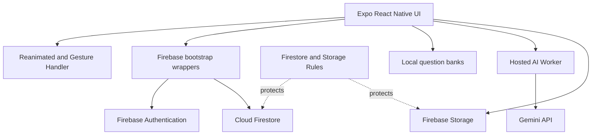

# kenetic


## Table of Contents

- [About Kenetic](#about-kenetic)
- [Tech Stack](#tech-stack)
- [Installation](#installation)
  - [Prerequisites](#prerequisites)
  - [How to Install](#how-to-install)
- [Features](#features)
  - [Account and Onboarding](#account-and-onboarding)
  - [State Dashboard](#state-dashboard)
  - [Get Shit Done](#get-shit-done)
  - [Alien Mode](#alien-mode)
  - [Guided Breathing](#guided-breathing)
  - [Bio Radar](#bio-radar)
  - [Curiosity Quizzes](#curiosity-quizzes)
  - [Spot Keeper](#spot-keeper)
  - [Daily Challenges](#daily-challenges)
  - [Activity and Profile](#activity-and-profile)
- [Demo](#demo)
- [Product Overview](#product-overview)
  - [Focus](#focus)
  - [Breathe](#breathe)
  - [Outdoors](#outdoors)
- [Architecture](#architecture)
  - [AI setup and restrictions](#ai-setup-and-restrictions)
- [Technology](#technology)
- [How To Use The App](#how-to-use-the-app)
- [Environment Variables](#environment-variables)
- [Project Structure](#project-structure)
- [Verification](#verification)
- [Known Product Boundaries](#known-product-boundaries)
- [License](#license)
- [Acknowledgments](#acknowledgments)
- [Author](#author)

## About Kenetic

kenetic is a mobile wellbeing and environmental-awareness app built around
small physical actions. It helps users move between focused work, breathing
and restoration practices, and attentive outdoor exploration without turning
those activities into a passive content feed.

The app is a mobile-only React Native / Expo application for Android and iOS.
Firebase provides authentication and remote persistence. Alien Mode and
Bio Radar require the separately configured hosted AI service described below.

## Tech Stack

| Technology | Role |
| --- | --- |
|  **React Native** | Cross-platform mobile interface |
|  **Expo** | Mobile development and native capabilities |
|  **TypeScript** | Application and backend code |
|  **Firebase** | Authentication and Cloud Firestore persistence |
|  **Cloudflare Workers** | Hosted AI service |
|  **Gemini** | AI-assisted task breakdown and nature discovery |

## Installation

These steps set up the mobile frontend, Firebase backend, and hosted AI service
for a development preview. They do not publish an app to an app store. Firebase
Authentication and Firestore can be used on the Spark plan within their free
quotas; Cloudflare and Gemini also have usage limits. Check current pricing and
account settings before deploying: free-tier limits do not guarantee zero
charges if billing is enabled.

### Prerequisites

**Software and device**

- [Git](https://git-scm.com/downloads) to clone the repository.
- [Node.js and npm](https://nodejs.org/en/download): Node.js 22.13 or newer in
  the 22.x line, 24.3 or newer in the 24.x line, 26.x, or 27 or newer. npm is
  included with Node.js. Check both with `node --version` and `npm --version`.
- A phone with [Expo Go](https://expo.dev/go) compatible with this project's
  Expo SDK, or an Android emulator / iOS simulator. See
  [Expo's environment setup guide](https://docs.expo.dev/get-started/set-up-your-environment/).
  For a physical iPhone, sign in to the same Expo account on Expo Go and the
  CLI; see [Expo's sign-in guide](https://docs.expo.dev/troubleshooting/expo-go-sign-in-required/).
- An [Expo account](https://expo.dev/signup) for the iPhone development
  preview. The computer and phone should be on the same network for LAN use.
- Java is only required for the optional
  [Firebase emulator and rules tests](https://firebase.google.com/docs/emulator-suite/install_and_configure).

**Accounts and keys**

- A [Firebase project](https://console.firebase.google.com/) with
  Authentication and Cloud Firestore. Register a **Web app** to obtain the
  Firebase JavaScript configuration; this does not make Kenetic a web app.
  Enable **Anonymous** and **Email/Password** sign-in.
- For Alien Mode and Bio Radar, a [Cloudflare account](https://dash.cloudflare.com/sign-up),
  [Workers access](https://developers.cloudflare.com/workers/get-started/guide/),
  and a [Gemini API key](https://aistudio.google.com/apikey). Confirm that the
  configured Gemini model and unpaid access are available in your region.
  The AI service is optional for the rest of the app, but those two features
  cannot work without it.
- The project uses the Firebase CLI installed by `npm ci`; Wrangler is run
  through `npx` for AI deployment. React Native, Expo, TypeScript, and other
  app packages are installed from the repository's lockfile, not individually.
- Optional profile-photo uploads require a [Cloudinary account](https://cloudinary.com/)
  and an unsigned upload preset. Google Places and Google/Apple sign-in keys
  are not needed for the current manual Spot Keeper and email/password flows.
  Firebase Storage and deployed Firebase Functions require a billing-enabled
  plan; they are not required for the core free-tier setup.

### How to Install

Run the following commands in a terminal. Commands start from the project root
unless a step changes directories.

**1. Clone the project and install frontend dependencies**

```bash
git clone https://github.com/Dhiali/Kenetic.git
cd Kenetic
npm ci
```

`npm ci` installs the locked versions. If dependencies are deliberately changed,
update the manifest and lockfile together; do not upgrade Expo or other core
packages merely to run the existing project.

**2. Configure Firebase and its security rules**

1. In the [Firebase Console](https://console.firebase.google.com/), create a
   project, register a Web app, and copy its configuration. Enable Anonymous
   and Email/Password under Authentication, then create a Cloud Firestore
   database. See [Firebase setup](https://firebase.google.com/docs/web/setup)
   and [Firestore setup](https://firebase.google.com/docs/firestore/quickstart).
2. Copy the environment template:

   ```powershell
   Copy-Item .env.example .env.local
   ```

   On macOS/Linux, run `cp .env.example .env.local` instead. Do not overwrite
   an existing `.env.local` containing configuration you want to keep.
3. Fill in these values in `.env.local` from the Firebase Web app settings:

   ```dotenv
   EXPO_PUBLIC_FIREBASE_API_KEY=your-firebase-api-key
   EXPO_PUBLIC_FIREBASE_AUTH_DOMAIN=your-project.firebaseapp.com
   EXPO_PUBLIC_FIREBASE_PROJECT_ID=your-project-id
   EXPO_PUBLIC_FIREBASE_MESSAGING_SENDER_ID=your-sender-id
   EXPO_PUBLIC_FIREBASE_APP_ID=your-app-id
   ```

4. Sign in to Firebase and deploy **only** the Firestore rules to the project
   you created. Replace the placeholder with your actual project ID:

   ```bash
   npx firebase login
   npx firebase deploy --only firestore:rules --project YOUR_FIREBASE_PROJECT_ID
   ```

   This changes the rules on the selected live Firebase project. Confirm the
   project ID first; it does not deploy Functions or Storage.

**3. Set up the AI backend for Alien Mode and Bio Radar**

1. In [Google AI Studio](https://aistudio.google.com/apikey), create a Gemini
   API key. Keep it private.
2. Open `ai-worker/wrangler.toml`. Set `FIREBASE_PROJECT_ID` to the same
   Firebase project ID used in `.env.local`; the checked-in value is an example,
   not your project. Set `ALLOWED_COUNTRIES` to comma-separated ISO country codes
   where unpaid Gemini use is permitted, and choose a Worker name appropriate
   for your Cloudflare account. Preserve the Durable Object binding and migration.
3. From the project root, sign in to Cloudflare, save the key as a Worker
   secret, and deploy:

   ```bash
   cd ai-worker
   npx wrangler login
   npx wrangler secret put GEMINI_API_KEY
   npx wrangler deploy
   cd ..
   ```

   Enter the Gemini key when prompted; never put it in `.env.local`, app code,
   or an `EXPO_PUBLIC_` variable. Wrangler prints the deployed Worker's HTTPS
   address. See [Wrangler documentation](https://developers.cloudflare.com/workers/wrangler/).
4. Add the Worker origin to `.env.local`:

   ```dotenv
   EXPO_PUBLIC_AI_SERVICE_URL=https://your-worker.example.workers.dev
   ```

   Review [AI setup and restrictions](#ai-setup-and-restrictions), including
   country restrictions, consent, and quotas, before using or sharing the app.

**4. Start the frontend**

```bash
npx expo login
npx expo start --lan
```

Sign in with the Expo account used on your phone. Open Expo Go and scan the QR
code. On iPhone, use the Camera app to open the
link; on Android, use the Expo Go scanner. If the port is occupied, accept
Expo's offered alternative. After changing `.env.local`, restart Expo and
fully reload the app so public variables are included in the bundle. This LAN
preview is for development, not public distribution.

**5. Check the installation**

```bash
npm run typecheck:app
npm run test:breathing
npm run test:outdoor-data
npm run test:auth
npm run test:ai-worker
```

Create an account on the phone and verify Firestore-backed actions. For AI,
accept the in-app agreement and test Alien Mode and Bio Radar. If AI says it
is not configured, check the Worker URL in `.env.local`, restart Expo, and
reload. More checks are listed under [Verification](#verification).

**Optional: Firebase Functions**

The separate `functions/` package uses Node.js 20 and is not required for the
core app or hosted AI service. To install and build it:

```bash
npm ci --prefix functions
npm run typecheck:functions
```

Deploying Functions requires a billing-enabled Firebase plan. Only after
reviewing costs and selecting the intended project, deploy with
`npx firebase deploy --only functions --project YOUR_FIREBASE_PROJECT_ID`.
Firebase emulators can be used for the repository's rules tests; the mobile
app is not currently wired to connect to them, so use a configured Firebase
project for the app itself.

**Optional: Profile-photo uploads**

Create an unsigned upload preset in Cloudinary using its
[upload preset guide](https://cloudinary.com/documentation/upload_presets), then
set `EXPO_PUBLIC_CLOUDINARY_CLOUD_NAME` and
`EXPO_PUBLIC_CLOUDINARY_UPLOAD_PRESET` in `.env.local`. These values are public
client configuration; configure the preset's restrictions appropriately and
review the provider's usage limits. Restart Expo and reload the app after editing
the file.

## Features

The screenshot notes below identify the screens to capture for the feature
mockups. Add your finished mockups here when they are ready.

### Account and Onboarding

Users can create an account or sign in with email and password, choose an
initial intention, and complete the onboarding flow. Signed-in users can resume
their saved progress when they return.

**Mockup screenshot:** Capture the **Where to?** screen showing the Return and
Begin choices.

### State Dashboard

The dashboard offers three paths—Focus, Breathe, and Outdoors. Users drag a
state upward to enter its activities.

**Mockup screenshot:** Capture the main dashboard with all three state choices
visible.

### Get Shit Done

Users choose Apple Music or Spotify and a focus duration. The focus timer starts
when they return to Kenetic after opening their music app.

**Mockup screenshot:** Capture the **Stay with it** screen while a focus timer
is running.

### Alien Mode

With the user's agreement, Alien Mode sends an overwhelming task to the AI
service and presents small suggested steps. Users choose a 1–10 minute focus
session, finish a step, and review the next one.

**Mockup screenshot:** Capture the **Start small** screen showing the first
suggested step and focus-time choices.

### Guided Breathing

Four guided practices offer visual and haptic cues. Users can choose flexible
guidance or chest-based, motion-sensitive guidance before starting.

**Mockup screenshot:** Capture an active breathing session showing the
countdown and current breathing cue.

### Bio Radar

After AI consent, users photograph something in nature and receive a possible
discovery with a description and uncertainty. Saved descriptions can later be
used in quizzes. Results are AI estimates, not verified identifications or
safety advice.

**Mockup screenshot:** Capture the **Possible discovery** result card with its
description and Save action.

### Curiosity Quizzes

Users revisit descriptions saved through Bio Radar and answer curated
general-nature questions. Answers are saved, and daily questions refresh at
midnight UTC.

**Mockup screenshot:** Capture a quiz question with its answer choices visible,
preferably one based on a saved Bio Radar discovery.

### Spot Keeper

Users manually save, rename, and delete places they want to revisit. Spot Keeper
does not search for nearby places.

**Mockup screenshot:** Capture **Spot keeper** with at least one saved place
visible.

### Daily Challenges

Each account receives a grounding activity for a rolling 24-hour window. A
countdown shows when the next challenge arrives, and completed challenges are
saved in a history list.

**Mockup screenshot:** Capture **A moment outside** after completing a
challenge, showing the countdown and completed-challenge list.

### Activity and Profile

The state dashboards show saved activity, while Profile lets users manage
their account and review or withdraw their AI agreement.

**Mockup screenshot:** Capture **Your focus activity** on the Focus dashboard
with its recent activity and mode breakdown visible.

## Demo

Demo video: **[Google Drive demo link](https://drive.google.com/file/d/1YRzw8xiRb9WkZUY4YqnlT9OEe4CRp3Xo/view?usp=sharing)**

## Product Overview

The main flow is:


### Focus

Focus is designed for starting a task and reducing friction around the first
small action. Get Shit Done opens the chosen music app and starts the focus
timer when the user returns to Kenetic; there is no music-selection deadline.
The timer uses a saved deadline so it can resume after the app is closed.
Kenetic does not control music playback or lock other apps. Alien Mode sends
the task to Gemini with the user's consent and presents suggested small steps.
The user chooses 1–10 minutes per step and drags up to start the timer. They
can finish early or wait for the timer, then review and start the next suggested
step. Starting each focus session stores the original task and current step in
Firestore; the suggested plan is also saved locally per account for recovery.
Focus activity shows completed sessions and time for the last seven local
calendar days (including today), all-time totals, and a breakdown by mode.

### Breathe

Breathe presents calm down, recenter, clear mind, and deep relax as swipeable
exercise cards. Exercise launches and session completion data are persisted so
the dashboard can show completed sessions, their duration, and the completion
rate for sessions started during the current week. The rate is not a measure of
recovery. Before an exercise, users can choose flexible on-screen and haptic
guidance or chest-based motion-sensitive guidance. In chest mode, movement pauses
the cues but the session timer continues; a still phone resumes the cues. The
choice is restored with an active session.

### Outdoors

The Outdoors state connects the user's real-world discoveries to lightweight
learning:

- **Bio Radar:** sends a photo to Gemini after
  consent. The result is an uncertain estimate, not a safety identification.
- **Curiosity Quizzes:** offers daily curated general-nature questions alongside
  recall questions based on saved Bio Radar descriptions. Those descriptions
  remain uncertain AI estimates, not verified facts or safety advice. Quiz
  questions do not send discoveries back to AI.
- **Spot Keeper:** lets users manually save, rename, and delete places.
  Nearby search is not available.
- **Daily Challenges:** offers a grounding activity for each rolling 24-hour
  window beginning when the user first opens it. A new activity appears after
  each window whether or not the previous one was completed; progress is saved
  per account. A live countdown shows when the next challenge arrives, and
  completed challenges appear in a saved history.

When saved, Bio Radar records the scan source, visual mode, AI result,
and session lifecycle; it does not save the photo to Firestore.
Curiosity Quizzes records the selected answer result and retention
action. The Outdoors dashboard aggregates species scanned, quiz attempts,
mastery percentage, and active learning days.

## Architecture



The application keeps Firebase calls behind `src/lib/firebase/bootstrap.ts`.
Those wrappers establish an authenticated or anonymous user before calling
the typed Firestore functions in `src/lib/firebase/firestore.ts`. This keeps
screen components focused on interaction state and prevents collection paths
from being duplicated throughout the UI.

The mobile app starts at `App.tsx`; run `npm run typecheck:app` to check its
dependency graph. Firebase Functions is a separate Node project; install its
locked dependencies with `npm ci --prefix functions` and run
`npm run typecheck:functions` to build it. The root TypeScript configuration
also includes the separate, unused `src/app` Router/template code and is not
the app-only check. Firebase's React Native persistence declaration is supplied
locally because Firebase's public TypeScript export resolves to its browser
types, while Metro uses its React Native implementation.

### AI setup and restrictions

The service in `ai-worker/` is not deployed by default. It requires a free
Cloudflare Workers account, a Gemini API key kept as a Worker secret, and the
same Firebase project ID as the app. Set `FIREBASE_PROJECT_ID` and a
comma-separated `ALLOWED_COUNTRIES` list in `ai-worker/wrangler.toml`, using
only countries where Gemini unpaid services are permitted. Requests without a
Cloudflare country or from the UK, EEA, or Switzerland are rejected. IP-based
geolocation and age self-attestation cannot guarantee eligibility; the app
must not be directed at or likely accessed by children.

Deploy only after verifying the target Cloudflare account, country list,
Firebase project, current Gemini terms and free-tier model availability. Add
the Gemini key with `npx wrangler secret put GEMINI_API_KEY` from `ai-worker`;
never put it in app code or an `EXPO_PUBLIC_` variable. Set only the Worker's
public HTTPS origin in `EXPO_PUBLIC_AI_SERVICE_URL` for the Expo preview
environment. Saving AI discoveries additionally requires deploying the updated
Firestore rules to the confirmed Firebase project. No deployment or billing
configuration is performed automatically.

Each user is shown an AI agreement before first use; the account-level
agreement covers both Alien Mode and Bio Radar and can be reviewed or
withdrawn in Profile. Each task or photo is sent only after the user initiates
that action. The app checks the agreement with Firestore before each AI request,
so a connection is required. Unpaid Gemini input and
output may be reviewed by people and used to improve Google's products; do not
send personal, confidential, or sensitive content. Daily limits are 10
requests per Firebase user and 100 total, resetting at midnight UTC; rejected
provider calls also use a request. Google's own quota may be lower and resets
on its own schedule. The hosting plan and Google project must remain on their
free tiers; a usage cap does not prevent charges if billing is enabled.

User-owned records are stored below:

```text
users/{uid}/
  sessions/
  scanHistory/
  quizHistory/
  outdoorFeatureLaunches/
  dashboardSelections/
  metrics/
  devices/
  notificationEvents/
  savedPlaces/
  challengeProgress/
```

## Technology

- React 19.3 and React Native 0.88
- Expo SDK 58
- TypeScript
- Firebase JavaScript SDK 12
- Firebase Authentication, Cloud Firestore, and Firebase Storage
- `react-native-reanimated` for tweening, fades, spring motion, morphing,
  progress states, and screen transitions
- `react-native-gesture-handler` for swipe, drag, and hold interactions
- `expo-haptics` for micro-actions and tactile feedback
- `expo-camera`, `expo-location`, `expo-sensors`, and
  `expo-notifications` for native capabilities
- `expo-blur` and `expo-linear-gradient` for visual depth
- Optional Cloudinary profile-photo uploads

## How To Use The App

### First launch

1. Open the app in Expo Go or a native build.
2. Move through the splash, authentication, intake, and onboarding screens.
3. Complete the onboarding ritual to reach the gateway and dashboard.
4. Drag Focus, Breathe, or Outdoors upward on the dashboard to open it.

Signed-in users resume unfinished onboarding after restarting. If startup or
onboarding cannot load or save their data, the app shows an error and retry
option rather than silently skipping the step.

### Navigation and micro-actions

- Drag the labelled action to the right when prompted. On supported screen
  readers, new swipe actions also expose an activate accessibility action.
- Account choices, email sign-in and signup, the initial intention,
  onboarding completion, dashboard states, and profile choices
  also expose screen-reader activation. Signup activation agrees to the terms
  and submits the form, just like the drag gesture. Screen-reader coverage is
  still partial and requires VoiceOver and TalkBack device testing.
- Swipe right on navigation rows to return to the previous state.
- On screens with text fields, scroll to reach the rest of the form and drag
  the page to dismiss the keyboard.
- Drag text tokens into their muted target states to confirm an action.
- Hold the Bio Radar reticle for two seconds to begin a scan.
- Haptic feedback marks important starts, drops, successes, warnings, and
  failures.
- In Daily Challenges, drag to start or complete the current challenge, or
  clear its progress before completion. In Spot Keeper, save a named place and
  drag to edit or delete it.
- Spot Keeper uses manually saved places and does not request location or use
  Google Places.
- Reanimated tweening and spring motion provide progress, snap, reveal, and
  screen-transition feedback.

### Bio Radar

1. Open **Outdoors** and choose **Bio Radar**.
2. Read and agree to the AI privacy notice, then grant camera permission.
3. Hold the reticle for two seconds to send a photo.
4. Review the AI estimate and uncertainty. Do not use it to make safety decisions.
5. Drag `save discovery` right to save the result for later recall in quizzes.

The scan is stored in `users/{uid}/scanHistory`. A matching outdoors session is
started before processing and completed when the discovery is saved, or marked
abandoned if the user exits early.

### Curiosity Quizzes

1. Open **Curiosity Quizzes** from Outdoors.
2. The lobby loads saved Bio Radar descriptions and daily general questions.
3. Drag `begin question` right, then drag an answer right to select it.
4. Review the answer and drag `save answer and continue` right to record it.
   Bio Radar answers repeat the saved AI estimate; they do not verify it.

The queue uses up to five recent unique discoveries plus curated questions,
and excludes questions already answered that UTC day. Saved discoveries,
including earlier Bio Radar results, can be revisited on later days. A failed
remote load or save has a retry path instead of appearing successful.

### Dashboard and profile

The dashboard shows state navigation and persisted activity. Outdoors metrics
include species scanned, quiz answers, mastery index, and active learning days.
Profile contains account and preference management. Anonymous activity can be
associated with a registered account through the authentication flow.

## Environment Variables

Required Firebase client configuration:

```dotenv
EXPO_PUBLIC_FIREBASE_API_KEY=
EXPO_PUBLIC_FIREBASE_AUTH_DOMAIN=
EXPO_PUBLIC_FIREBASE_PROJECT_ID=
EXPO_PUBLIC_FIREBASE_MESSAGING_SENDER_ID=
EXPO_PUBLIC_FIREBASE_APP_ID=
```

Optional integrations:

```dotenv
EXPO_PUBLIC_AI_SERVICE_URL=
EXPO_PUBLIC_FIREBASE_STORAGE_BUCKET=
EXPO_PUBLIC_FIREBASE_ENV=development
EXPO_PUBLIC_GOOGLE_PLACES_API_KEY=
EXPO_PUBLIC_GOOGLE_WEB_CLIENT_ID=
EXPO_PUBLIC_GOOGLE_ANDROID_CLIENT_ID=
EXPO_PUBLIC_GOOGLE_IOS_CLIENT_ID=
EXPO_PUBLIC_CLOUDINARY_CLOUD_NAME=
EXPO_PUBLIC_CLOUDINARY_UPLOAD_PRESET=
```

## Project Structure

```text
App.tsx                         Expo entry point
app.json                        Expo permissions and native configuration
src/app/                        App routing and layout
src/screens/                    Feature screens and experiences
src/components/                 Shared UI components
src/lib/firebase/app.ts         Firebase app initialization
src/lib/firebase/auth.ts        Auth and anonymous-user helpers
src/lib/firebase/bootstrap.ts   Auth-aware feature wrappers
src/lib/firebase/firestore.ts   Types, collections, CRUD, and metrics
src/lib/firebase/storage.ts     Storage helpers
src/constants/                  Theme constants
src/theme/                      Shared colors and visual tokens
firestore.rules                 Firestore ownership and validation rules
storage.rules                   Storage ownership rules
firebase.json                   Firebase services and emulator ports
functions/                      Optional Firebase Functions package
assets/images/kenetic-icon.png  Application icon PNG
```

## Verification

Run the production-style bundle check before sharing a build:

```bash
npm run typecheck:app
npm run typecheck:functions
npm run test:auth
npm run test:account-restore
npm run test:breathing
npm run test:curated-quiz
npm run test:session-storage
npm run test:focus-timing
npm run test:ai-worker
node --test scripts/test-ai-consent.cjs
npm run test:outdoor-data
npm run test:firestore-rules
npm run test:storage-rules
npx expo export --platform all
```

The outdoor data tests use an in-memory Firestore mock. They do not verify
deployed Firebase rules, offline behavior, or physical-device interaction.
The rules tests use local Firebase emulators and the demo project ID, never a
live project. They require Java on `PATH` and may download emulator binaries
on first use. Passing them does not deploy rules or configure live Storage.

For backend changes, deploy or test the rules against the intended Firebase
project. For device features, test permissions and gestures on a physical
device because camera and haptics
are not fully represented in a web browser.

## Known Product Boundaries

- Sign-in and signup use email and password. Apple and Google sign-in options
  are not available; existing provider-only accounts cannot sign in through
  the current app after signing out.
- Push notification prompts and settings are unavailable because delivery is
  not implemented. Previously saved notification preferences remain stored.

- Bio Radar sends a photo to the configured AI service after consent; its
  species identification is an uncertain estimate and not safety advice.
- Curiosity Quiz questions come from a maintained local question bank; they
  are not generated dynamically by an AI model.
- Spot Keeper currently supports manually saved places only; nearby search is
  unavailable.
- Bio Radar photos are not saved to Firestore. Live Firebase Storage requires
  billing-enabled configuration and has not been validated in this setup;
  optional profile-photo uploads require separate Cloudinary configuration.
- New breathing and Alien Mode timers are stored per account (and breathing
  exercise). Older locally saved timers lack account identification and cannot
  safely be resumed automatically after this update; their Firestore records
  remain unchanged.
- If saving an expired breathing or Alien Mode session fails, the user can
  retry saving it. Leaving preserves the local session for a later retry.

## License

All rights reserved.

## Acknowledgments

Thanks to Tsungai Katsuro and William Basson for their support and
contributions. We also acknowledge these AI tools and the Stack Overflow
community:

[](https://gemini.google.com/)
[](https://chatgpt.com/)
[](https://stackoverflow.com/)

## Author

[Dhiali](https://github.com/Dhiali)
